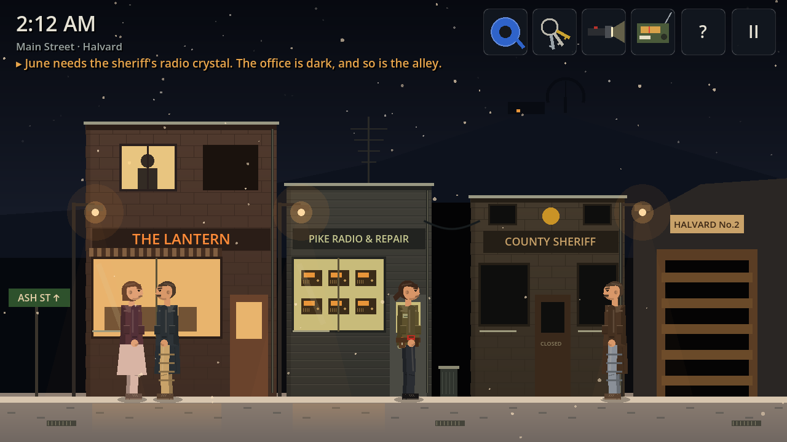

# Off Frequency — v0.3.2

A 2D sci-fi point-and-click mystery for Android (iOS later), built in **Godot 4.7** with GDScript.
The full story is in the *Off Frequency — Story Bible* doc; this build covers the prologue, Act 1 and Act 2.



## What's in v0.3

About 70–80 minutes of play. Both branches of Choice 1 and both of Choice 2, from the 1980 snowfield to the mine under the mountain.

### New in v0.3.2: no more fake voices

- **Main Street** now sounds like a street full of people at 2 AM instead of a murmur: boots crunching past at different distances, doors, a snow shovel, someone stamping off snow, a cough, keys, a car door, a car crawling by on packed snow, a dog blocks away, somebody whistling. Louder than before, with a little echo off the house fronts.
- **Radios are radio**, with no speech-like sound anywhere. The police scanner (Pike Radio, the sheriff's office, station 05) opens its squelch on weak, fluttering carriers, with roger beeps and a data burst. June's shop adds a shortwave loop: Morse code, a tuning whistle, fading static. Under the 2:14 voice's lines, the squelch opens on a fading, warbling carrier.
- Every other sound is byte-for-byte unchanged.

### New in v0.3.1: chapter select (debug)

The title screen has a **Chapters (debug)** button (debug builds only, which includes this APK). Pick a tab (Prologue, Act 1, Act 2), set how **Choice 1** and **Choice 2** went, and tap a chapter. You start there with the story set exactly as a full playthrough reached it: inventory, flags, frequency, `FRACTURE`, clock, emergency lighting. Jumping replaces your save, so **Continue** resumes from the chapter.

| | Starts in | | | Starts in |
| --- | --- | --- | --- | --- |
| P1 The snowfield, 1980 | snowfield (new game) | | 2.1 Main Street | Main Street, arriving |
| P2 Night shift | main corridor, 1:40 | | 2.2 Pike Radio | June's shop |
| P3 2:14 AM | receiver room, fuse in hand | | 2.3 Cal's crystal | Main Street, after June's diagnosis |
| 1.2 The body | control room | | 2.4 Eighty-One | Ash Street, radio repaired |
| 1.3 The phone | lobby | | 2.5 The Lantern | the diner |
| 1.4 The first crossing | corridor, calls made | | 2.6 Snowfield, 1980 | frequency 12, with Ma's truck keys |
| 1.5 Light keeps you home | corridor, back from 01 | | 2.7 The mine tunnel | the tunnel mouth |
| 1.6 Tomas's box | basement | | | |
| 1.7 The garage | garage | | | |
| 1.8 The road down | the snowcat, on 03 | | | |

Choice 1 matters from 1.2 on; Choice 2 only for 2.7. The starting states are recorded from the automated playthroughs (see Testing), so they stay correct as the game changes: rerun and regenerate.

### New in v0.3: Act 2, "The overlap"

| Part | Scene | What happens |
| --- | --- | --- |
| **Act 2.1** | Main Street | The hub. Every light in town on at 2 AM, people outside in pajamas, Mr. Lund beside his wife and also at their kitchen window. |
| **Act 2.4a** | Ash Street | Mom's house is lit. Under the broken streetlight, the Tuner shows each station's version of the house behind it, but none is dark: the dial stops at 09. |
| **Act 2.2** | Pike Radio & Repair | June Pike finds the cracked crystal. The only match is in the sheriff's base radio. |
| **Act 2.3** | Sheriff's office, frequency 05 | Through the dark alley to 05, where it's already Oct 17: Cal asleep beside his board for Mara's murder. Doormat under the filing cabinet, pull the plug, take the crystal. June fits it: the dial reaches 99 (bands of ten: −10 / +10). |
| **Act 2.4** | Ash Street 14, the kitchen | Tune to 14: the house is dark and for sale. Eighty-One, by match light; ask your questions in any order. Then a third Mara at the back door, the match goes out, and the player is someone else. Nothing says so. |
| **Act 2.5** | The Lantern diner | Ma. Ask for pie to send her to the front, unscrew the pantry bulb, shut the door, tune to 12. |
| **Act 2.6** | 1980, frequency 12 | A younger Ma ("Did you cut your hair?"), her truck keys, the snowfield seen from the treeline. **Choice 2:** take Tomas, or send him back to his sister. Sets `TOMAS`. |
| **Act 2.7** | The mine tunnel | The dish is turning by itself; June calls on the radio. The flashlight dies in the cold, and in total darkness you keep the drifting needle on home while Mara walks. Halfway, every sound stops. |

Everything Act 2 adds works with the **?** hint button from the start.

### The prologue and Act 1 (from v0.2)

| Part | Scene | What happens |
| --- | --- | --- |
| Prologue P1 | Snowfield, Oct 14, 1980 | Tomas: "It's talking back." Lock the gate, turn back: he's gone. |
| Prologue P2 | Main corridor, 1:40 AM | Sollen's note, Mara's locker (red tape), the fuse puzzle (spares cabinet → vending machine). |
| Prologue P3 | Receiver room, 2:13 → 2:14 | The transmission, the knock, every clock stops. |
| Act 1.1 | Receiver room | **Choice 1:** answer the voice, or cut the power. Sets `ANSWERED`. |
| Act 1.2 | Control room | Mara's body: blue tape, a watch stopped at 2:14, the "81" note. |
| Act 1.3 | Lobby | Splice the phone with red tape, three calls into three frequencies. The last one rings in Sollen's office. |
| **Act 1.4** | East wing, frequency 01 | Walking into the dark wing slips Mara into **01**: lights on, Sollen asleep, fire doors chained. Take his keys and scarf, unscrew the hot bulb, shut his door, and cross home in the dark. |
| **Act 1.4** | Home again | Booth flashlight (dead) + the frozen clock's batteries. Sollen's office: receiver off the hook and still warm, the 1980 station log, Tomas's tape, the garage key. |
| **Act 1.5–1.6** | Basement | Tomas's crate: his radio (the Tuner), the Day 41 tape, a notebook-shaped gap in the dust. Then the knock at the delivery door, in Mara's own voice. |
| **Act 1.7** | Garage, frequency 03 | Empty tank, a pine across the road. Red tape on the wrist, flashlight off, tune to 03: road plowed, tank full. |
| **Act 1.7** | The road down | Halvard's windows breathing, the underpass, the engine dies in total darkness. Find home on the dial. |

### New in v0.2.1: hints

- **The ? button now tells you exactly what to do next**, wherever you are, on either branch: which room to go to, what to tap, and which item to use on what. Then it lights up everything you can interact with, as before.
- Objectives are more specific at the steps that were easy to miss: the vending-machine fuse, the four things to check on the body, the junction box, the clock batteries and the caged lamp.
- Small hotspots (the watch, the fuse holder, the note) also catch taps that land just outside them.
- The Tuner panel says how to use it, and Mara tells you where home is on the dial at the underpass.

### The rules the player learns

- **Darkness is a door.** In the dark you slip into another version of the building; any light holds you where you are. Mara carries a flashlight so she can walk dark rooms safely.
- **Frequencies look and sound different.** Each one has its own colour cast and its building hum sits at its own pitch. Home has no mark on the Tuner's dial: it sits between 06 and 07.
- Every crossing adds 1 to `FRACTURE` (4 by the end of Act 1).

Branch differences: cutting the power switches home to red emergency light, leaves footprints in the lobby, makes Sollen's desk lamp dead (flashlight only), and changes what the woman at the basement door says.

## Play it

**On Android:** copy `OffFrequency-v0.3.2-debug.apk` to the phone, open it, and allow "Install unknown apps" when asked. It installs over earlier versions and keeps your save. Needs Android 7.0 or newer. It's a debug build, so it's for testing, not the Play Store.

**On your computer:** download Godot 4.7 (the standard build, not .NET), choose *Import*, pick this folder's `project.godot`, then press **F5**.

**Controls:** tap to walk; tap anything to look at or use it. Tap an inventory item to select it, then:
tap something in the room to use it there, tap **another item** to combine the two, or tap the **same item** again to examine it (examining Tomas's radio is how you use it). **?** tells you what to do next, then flashes everything you can interact with, even in the dark. **II** (or Android's back button) pauses and saves.

**The Tuner:** drag along the dial (or nudge with ◀ ▶). When a station locks, the green lamp lights and *Step into the dark* goes through. After June's repair, **−10 / +10** switch between bands (00–09, 10–19 ... 90–99). While a station is locked, the scene behind the panel shows a glimpse of that frequency.

## Project layout

```
project.godot              Settings: 1280x720 landscape, GL Compatibility renderer
scenes/main.tscn           Entry point (just runs scripts/main.gd)
scripts/
  game_state.gd            Autoload: story variables, flags, inventory, frequencies, recipes, save/load
  audio_manager.gd         Autoload: sound effects, ambience loops, the voice-acting hook
  main.gd                  Camera, HUD, room changes, crossings, input blocking during scenes
  hud.gd                   Clock, objective, inventory (combine/examine), dialogue, choices,
                           document reader, glitch effect, fades, menus
  tuner_ui.gd              Tomas's radio: the dial, bands, station sounds, lock lamp, hold mode
  story.gd                 Works out the objective and the ? button's hint from the flags
  chapters.gd              Debug chapter select: the chapter list and lookups
  chapter_states.gd        GENERATED: each chapter's starting state (tools/gen_chapters.py)
  room.gd                  Base class for every screen: hotspots, walking, frequency, darkness,
                           flashlight, glow layer, hint layer
  station_room.gd          Shared look and ambience for the observatory interior
  actor.gd                 Every character, drawn from shapes: Mara, Tomas, Sollen, June, Ruth,
                           Cal, Eighty-One, townspeople, the body, the silhouette
  kit.gd, snow.gd          Drawing helpers (including the snowcat) and falling snow
  rooms/*.gd               One file per room: menu, snowfield_1980, corridor, receiver_room,
                           control_room, lobby, east_corridor, sollen_office, basement,
                           garage, road_down, main_street, pike_radio, sheriff_office,
                           ash_street, ash_kitchen, diner, mine_tunnel, end_card
  autotest.gd              Automated playthroughs (see Testing)
audio/*.wav                Placeholder sounds, generated by tools/gen_audio.py
textures/*.png             Flashlight cone and glow, generated by tools/gen_textures.py
export_presets.cfg         Android export preset
```

## How the story code works

Every room extends `Room` and overrides a few functions. Scenes are coroutines, so a cutscene reads top to bottom:

```gdscript
func on_hotspot(id: String) -> void:
    match id:
        "locker":
            await mara("Tomas. Thirteen forever, taped inside a locker door.")
            GameState.add_item("red_tape")
            hud.toast("Got: Red tape")
        "receiver_door":
            main.change_room("receiver_room", "from_corridor")   # always the last line, never awaited
```

- **Story variables** live in `GameState.story`: `ANSWERED`, `TOMAS`, `EIGHTY`, `FINALE`, `FRACTURE` (matching the story bible). Smaller facts are flags: `GameState.set_flag("read_note")`, `GameState.has("read_note")`.
- **Frequencies**: every room has a `freq` ("H" for home, "01", "03"...) and draws its own version. `main.cross("01", "east_corridor", "first")` plays the glitch, adds 1 to `FRACTURE` and loads that room on that frequency. `GameState.FREQS` holds each frequency's tint and hum pitch.
- **Darkness**: a room returns `true` from `is_dark()` and the world drops to near-black. With the flashlight, Mara gets a real 2D light cone (`PointLight2D`). `add_lamp()` puts other lights in a room; anything drawn in `draw_glow()` is never darkened.
- **Hotspots**: `add_hotspot(id, rect, label, walk_x, face, condition)`. The smallest hotspot under a tap wins.
- **Items**: `use_item(hotspot, item)` for using an item on something, `GameState.RECIPES` for combining two items, `examine_item(item)` to override what examining does in a room.
- **Choices and documents**: `await hud.choose([...])`, `await hud.read_doc(title, pages)`.
- **The Tuner**: `var station := await tuner_session(refuse, start, band)`, where `refuse(station)` returns `""` to let Mara through or a line she says instead. While a station is locked, the room's `tuning` holds it, so `draw_back()` can show that frequency's version (Ash Street does this).
- **People behind counters and desks**: `add_layer(1, fn)` draws a prop in front of other characters but behind Mara.
- **Adding a room**: create `scripts/rooms/my_room.gd` extending `Room` (or `StationRoom`), then register it in `ROOMS` in `scripts/main.gd`.
- **Saving** happens automatically on every room change (including the frequency) and when the app is paused.

## Testing

The automated playthrough taps through the real game and checks the story state after each beat (556 checks across six runs, and every step must have a hint):

```
godot --headless --path . -- --autotest=answer        # answer the voice, then take Tomas: Acts 1 and 2
godot --headless --path . -- --autotest=cut           # cut the power, then leave Tomas
godot --headless --path . -- --autotest=answer_leave  # answer the voice, then leave Tomas
godot --headless --path . -- --autotest=cut_take      # cut the power, then take Tomas
godot --headless --path . -- --autotest=continue      # save, quit, Continue (also inside 01 and 05)
godot --headless --path . -- --autotest=chapters      # chapter select: every chapter, every choice combination
godot --headless --path . -- --check               # compile every room script and quit
godot --path . -- --autotest=tuner --shots=/tmp/t   # opens the Tuner in the dark garage and screenshots it
godot --path . -- --autotest=rooms --shots=/tmp/r   # screenshots every Act 2 room
```

Each exits with code 0 on pass, 1 on failure, so they can run in GitLab CI.

**Regenerating the chapter states** after changing the story: add `--chapters=FILE` to the four playthroughs, then build `scripts/chapter_states.gd` from them:

```
godot --headless --path . -- --autotest=answer       --chapters=ch_answer.json
godot --headless --path . -- --autotest=answer_leave --chapters=ch_answer_leave.json
godot --headless --path . -- --autotest=cut_take     --chapters=ch_cut_take.json
godot --headless --path . -- --autotest=cut          --chapters=ch_cut.json
python3 tools/gen_chapters.py ch_*.json
```

The playthrough marks where each chapter starts (`_mark("2.4", "ash_street")` in `autotest.gd`) and saves the state as that room loads. To add a chapter, add a `_mark` there and an entry in `Chapters.LIST`. Add `--shots=/some/folder` (and drop `--headless`) to also save screenshots of key moments, the Tuner and the documents.

## Building the APK yourself

1. Install Android Studio (for the Android SDK) and a JDK 17+.
2. In Godot: **Editor → Editor Settings → Export → Android**, set *Java SDK Path* and *Android SDK Path*. Godot creates a debug keystore itself.
3. **Editor → Manage Export Templates → Download** for 4.7.
4. **Project → Export → Android → Export Project**.

For Google Play you'll need a release keystore, an `.aab` (turn on *Use Gradle Build* and install the Android build template from the Project menu), target SDK 36 (Godot 4.7's default), and, for a new personal developer account, a 14-day closed test with 12 testers.

> This APK is signed with a debug key. A future build signed with a different key won't install over it; uninstall first.

## Voice acting

There are no recordings yet: lines show as subtitles, and under the 2:14 voice the squelch opens on a fading radio carrier (no fake speech). The hook for real actors is in place. If `voice/<key>.ogg` exists, where key is the first 16 hex digits of md5(`SPEAKER|exact line text`), `hud.say()` plays it and ducks the ambience under it. Nothing in the room scripts needs to change.

## Known limitations

- Art is drawn in code and the sound effects are synthesized placeholders, meant to be swapped for real assets: sounds by replacing files in `audio/` with the same names, art by giving `Actor` and the rooms sprite textures.
- Tested here with automated runs and rendered screenshots, but not yet on a physical phone. The 2D lights are the most demanding thing in the game; if a low-end phone struggles in dark rooms, lower `texture_scale` on the flashlight in `room.gd`.
- iOS export needs a Mac with Xcode and an Apple Developer account; nothing in the code is Android-only.

## Next: v0.4

Act 3: patching the Tuner into the dish, three possible futures (2031, 2009, 1991), the chalkboard that writes the next date by itself, Tomas's notebook in the wall, and Choice 3.
